### Homework1

```java
public class Homework1 {

	public static void main(String[] args) {
		// TODO Auto-generated method stub
		int i,j;
		for(i=0; i<10; i++) {
			  for(j=0; j<=i; j++) {
			    System.out.print(" ");
			  }
			  for(; j<=10; j++) {
			    System.out.print("#");
			  }
			  System.out.println();
         }
		
		for(i=0; i<10; i++) {
			  for(j=0; j<=i; j++) {
			    System.out.print("#");
			  }
			  for(; j<=10; j++) {
			    System.out.print(" ");
			  }
			  System.out.println();
	}
		
		for(i=10; i>=0; i--) {
			  for(j=0; j<=i; j++) {
			    System.out.print("#");
			  }
			  for(; j<=10; j++) {
			    System.out.print(" ");
			  }
			  System.out.println();
			  }
		
		for(i=10; i>=0; i--) {
			  for(j=0; j<=i; j++) {
			    System.out.print(" ");
			  }
			  for(; j<=10; j++) {
			    System.out.print("#");
			  }
			  System.out.println();
		}
	}
}
```

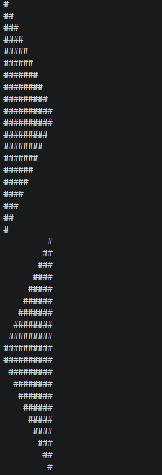
### Homework2
```java
public class HomeWork2 {
    public static void main(String[] args) {
        int i = 1; 
        int j = 1; 
        int k;

        System.out.print(i + "," + j);

        for(int count = 3; count <= 20; count++) {
            k = i + j;                 
            System.out.print("," + k); 

            i = j; 
            j = k; 
        }
    }
}
 ```
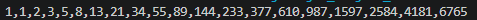
### Homework3
```java
### Homework3
public class Homework3 {
    public static void main(String[] args) {

        double i = 1;
        double j = 1;
        double k;
        
        for (int count = 3; count <= 20; count++) {
            k = i + j; 
           
            double ratio = k / j; 
            
            System.out.printf("%.6f\n", ratio);
            
          
            i = j;
            j = k;
        }
    }
}

```
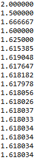
### Homework4
```java
public class Homework4 {
    public static void main(String[] args) {
        
        // i는 곱하는 수 (1부터 9까지 행 변경)
        for (int i = 1; i <= 9; i++) {
            
            // j는 구구단의 단 (1단부터 9단까지 열 변경)
            for (int j = 1; j <= 9; j++) {
                // \t는 탭 공백으로, 줄을 깔끔하게 맞춰줍니다.
                System.out.print(j + "*" + i + "=" + (j * i) + "\t");
            }
            
            // 한 행(i)의 출력이 끝나면 줄바꿈
            System.out.println();
        }
    }
}
```
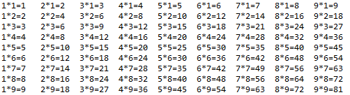
### Homework5
```java
public class Homework5 {
    public static void main(String[] args) {

        int i, j;
        double radius = 0;
        
        for(i=1; i<=10000000; i++) {
        	if (i % 4 == 1) {
        		radius += 4*(1.0/i);
        	}
        	else if (i % 4 ==3) {
        		radius -= 4*(1.0/i);
        	}
        }
       
        	System.out.printf("%.6f", radius);
    }
}
```
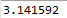
### Homework5-1
```java
public class Homework5_1 {
    public static void main(String[] args) {

        int i;
        double pi = 0;
        for(i=0; i<=1000000;i++) {
        	if(i%2 == 0) {
        		pi += (Math.pow(3,-i)/(2 * i + 1));
        	}
        	else {
        		pi -= (Math.pow(3, -i)/(2 * i  + 1));
        	}
        }
        pi = pi * Math.sqrt(12);
        System.out.printf("%.6f", pi);
    }
}
```
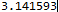
### Homework6
```java
public class Homework6 {
    public static void main(String[] args) {

        int[][] binomial = new int[n][];

        for (int i = 0; i < n; i++) {
            binomial[i] = new int[i + 1];
            binomial[i][0] = 1; 
            binomial[i][i] = 1; 

            for (int j = 1; j < i; j++) {
           
                binomial[i][j] = binomial[i - 1][j - 1] + binomial[i - 1][j];
            }
        }


        for (int i = 0; i < n; i++) {
            for (int j = 0; j <= i; j++) {
                System.out.print(binomial[i][j] + " ");
            }
            System.out.println();
        }
    }
}
```
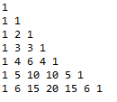
### Homework7
```java
public class Homework7 {
    public static void main(String[] args) {

        int data[] = new int[20];
        for (int i = 0; i < 20; i++) {
            data[i] = (int) (Math.random() * 100);
        }

        System.out.println("=== 정렬 전 ===");
        for (int i = 0; i < 20; i++) {
            System.out.print(data[i] + " ");
        }
        System.out.println("\n");

        for (int i = 0; i < data.length - 1; i++) {
            int minIndex = i; 
            
            for (int j = i + 1; j < data.length; j++) {
                if (data[j] < data[minIndex]) {
                    minIndex = j;
                }
            }
            
            int temp = data[i];
            data[i] = data[minIndex];
            data[minIndex] = temp;
        }

        System.out.println("=== 정렬 후 ===");
        for (int i = 0; i < 20; i++) {
            System.out.print(data[i] + " ");
        }
        System.out.println();
    }
}
```

### Homework8
```java
public class Homework8{
    public static void main(String[] args) {
        
        int[][] score = new int[30][4];

        
        for (int i = 0; i < 30; i++) {
            for (int j = 0; j < 4; j++) {
                score[i][j] = (int) (Math.random() * 101); 
            }
        }

        System.out.println("번호\t국어\t영어\t수학\t과학\t총점\t평균");
        System.out.println("-----------------------------------------------------");

       
        for (int i = 0; i < 30; i++) {
            int sum = 0;

            System.out.print((i + 1) + "\t");
            
            for (int j = 0; j < 4; j++) {
                System.out.print(score[i][j] + "\t");
                sum += score[i][j];
            }
            
            double avg = sum / 4.0;
            
            System.out.printf("%d\t%.1f\n", sum, avg);
        }
    }
}
```
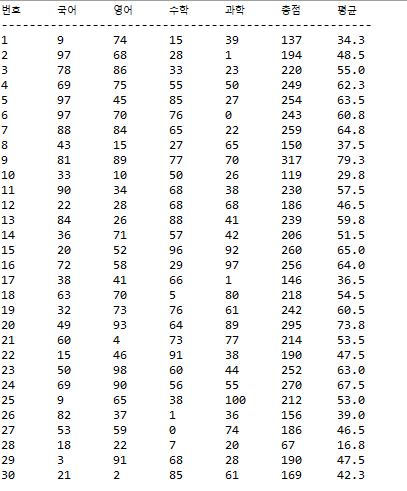

### Homework10
```java
public class Main {
	public static void main(String[] args) {
		// TODO Auto-generated method stub
		int array_count, max_value, bin_size, display_scale, hist_size;
		if(args.length !=4)
			return;
		array_count = Integer.parseInt(args[0]);
		max_value = Integer.parseInt(args[1]);
		bin_size = Integer.parseInt(args[2]);
		display_scale = Integer.parseInt(args[3]);
		hist_size = (max_value + bin_size - 1) / bin_size;   // 변경: 올림 계산

		int[] arr = new int[array_count];
		int[] hist = new int[hist_size];
		for (int i=0; i<array_count; i++) {
			arr[i] = (int) (Math.random()*max_value);
		}

		for (int i=0; i<array_count; i++) {
			hist[arr[i]/bin_size]++;
		}

		// 변경: 결과 출력 형식
		System.out.println("int data[" + array_count + "] 0~" + max_value);
		for (int i=0; i<hist_size; i++) {
			int low = i*bin_size;
			int high = Math.min(low + bin_size, max_value) - 1;
			System.out.print(low + "~" + high + "\t\t");
			for (int j=0; j<hist[i]/display_scale; j++) {
				System.out.print("#");
			}
			System.out.println();
		}
	}
}
```
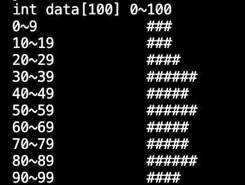

### Homework11
```java
public class Homework11 {
	public static void main(String[] args) {

		int array_count;
		if(args.length !=1)
			return;
		array_count = Integer.parseInt(args[0]);
		int[] arr = new int[array_count];
		for (int i=0; i<array_count; i++) {
			arr[i] = (int) (Math.random()*100);
		}
		for (int i=0; i<array_count; i++) {
			System.out.print(arr[i] + " ");  
		}
		System.out.println();
		double sum = 0;
		for (int i=0; i<array_count; i++) {
			sum+=arr[i];
		}
		System.out.printf("arithematic mean : = %f\n", sum/array_count);
		double prod = 1;
		for (int i=0; i<array_count; i++) {
			prod*=arr[i];
		}
		System.out.printf("harmonic mean : = %f\n", Math.pow(prod, (double)1./array_count));
		
	}
}
```
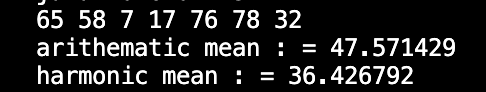

### Homework13
```java
import java.util.Scanner;

public class Calculator {
    public static void main(String[] args) {
        Scanner sc = new Scanner(System.in);  

        while (true) {
            System.out.print("계산식 입력 (예: 3 + 4) 또는 'exit' 입력: ");
            if (!sc.hasNextLine()) break;
            String input = sc.nextLine().trim();

            if (input.equalsIgnoreCase("exit")) {
                System.out.println("종료합니다.");
                break;
            }

            String[] tokens = input.split("\\s+");   
            if (tokens.length != 3) {
                System.out.println("형식: 숫자 연산자 숫자 (예: 3 + 4)");
                continue;
            }

            try {
                int a = Integer.parseInt(tokens[0]);
                String op = tokens[1];
                int b = Integer.parseInt(tokens[2]);

                if (op.equals("+")) {
                    System.out.println(a + b);
                } else if (op.equals("-")) {
                    System.out.println(a - b);
                } else if (op.equals("*")) {
                    System.out.println(a * b);
                } else if (op.equals("/")) {
                    if (b == 0) System.out.println("0으로 나눌 수 없습니다.");
                    else System.out.println(a / b);
                } else {
                    System.out.println("지원하지 않는 연산자입니다: " + op);
                }
            } catch (NumberFormatException e) {
                System.out.println("숫자가 올바르지 않습니다.");
            }
        }
        sc.close();
    }
}
```
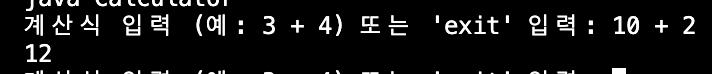

### Homework14
```java
package numbers;
public class Numbers {
	int num[];
	Numbers(int num[]) {
		this.num = num;
	}
	double getTotal() {
		double sum=0;
		for(int i=0; i<num.length; i++) sum+=num[i];
		return sum;
	}
	double getArithmaticMean() {
		return getTotal()/num.length;
	}
	// 조화평균 = n / (1/x1 + 1/x2 + ... + 1/xn)
	double getHarmonicMean() {
		double sum=0;
		for(int i=0; i<num.length; i++) sum+=1.0/num[i];
		return num.length/sum;
	}
	// 기하평균 = (x1 * x2 * ... * xn)^(1/n)
	// 곱이 너무 커지는 것(오버플로)을 막기 위해 로그로 계산: exp( (ln x1 + ... + ln xn) / n )
	double getGeometricMean() {
		double logSum=0;
		for(int i=0; i<num.length; i++) logSum+=Math.log(num[i]);
		return Math.exp(logSum/num.length);
	}
	// 중앙값: 정렬 후 가운데 값 (개수가 짝수이면 가운데 두 값의 평균, 정수로 반환하므로 소수점은 버림)
	int getMedian() {
		sorting();
		int n=num.length;
		if(n%2==1) return num[n/2];
		return (num[n/2-1]+num[n/2])/2;
	}
	// 선택 정렬 (오름차순, 원래 배열을 직접 정렬)
	void sorting() {
		for(int i=0; i<num.length-1; i++) {
			int min=i;
			for(int j=i+1; j<num.length; j++)
				if(num[j]<num[min]) min=j;
			int tmp=num[i];
			num[i]=num[min];
			num[min]=tmp;
		}
	}
	// 도수분포표: start 이상 end 미만 범위를 binSize 간격으로 나누고, # 하나가 scale개를 뜻한다 (남는 개수도 # 하나로 올림)
	void drawHistogram(int start, int end, int binSize, int scale) {
		if(binSize<=0 || scale<=0 || end<=start) {
			System.out.println("start < end 이고, binSize와 scale은 1 이상이어야 합니다.");
			return;
		}
		int histSize=(end-start+binSize-1)/binSize;
		int hist[]=new int[histSize];
		for(int i=0; i<num.length; i++) {
			if(num[i]>=start && num[i]<end)
				hist[(num[i]-start)/binSize]++;
		}
		System.out.println("int data["+num.length+"] "+start+"~"+end);
		for(int i=0; i<histSize; i++) {
			int low=start+i*binSize;
			int high=Math.min(low+binSize, end)-1;
			System.out.print(low+"~"+high+"\t\t");
			for(int j=0; j<(hist[i]+scale-1)/scale; j++) System.out.print("#");
			System.out.println();
		}
	}
	void display() {
		System.out.printf("%3d :", num.length);	
		for(int i=0; i<num.length; i++) 
			System.out.printf("%3d ", num[i]);
		System.out.println();
	}
}

package numbers;
public class NumbersTest {
	public static void main(String[] args) {
		int size=100;
		int data[]=new int[size];
		for(int i=0; i<size; i++) 
			data[i]=(int)(Math.random()*100);
		Numbers obj = new Numbers(data);
		obj.display();
		System.out.printf("Arithmetic Mean : %5.2f\n", obj.getArithmaticMean());
		System.out.printf("Geometric Mean : %5.2f\n", obj.getGeometricMean());	
		System.out.printf("Harmonic Mean : %5.2f\n", obj.getHarmonicMean());
		System.out.printf("Median : %d\n", obj.getMedian());
		obj.drawHistogram(0,100,10,10);	// start, end, binSize, scale
	}
}

```
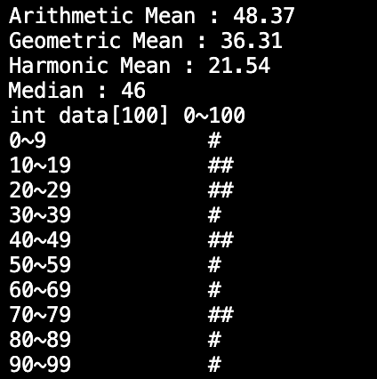
